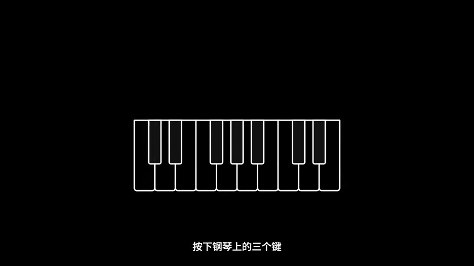
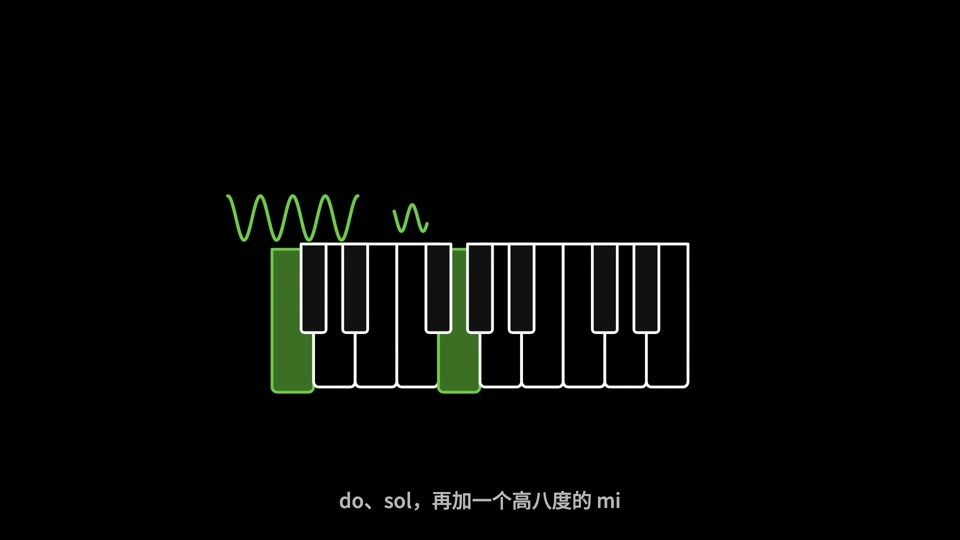
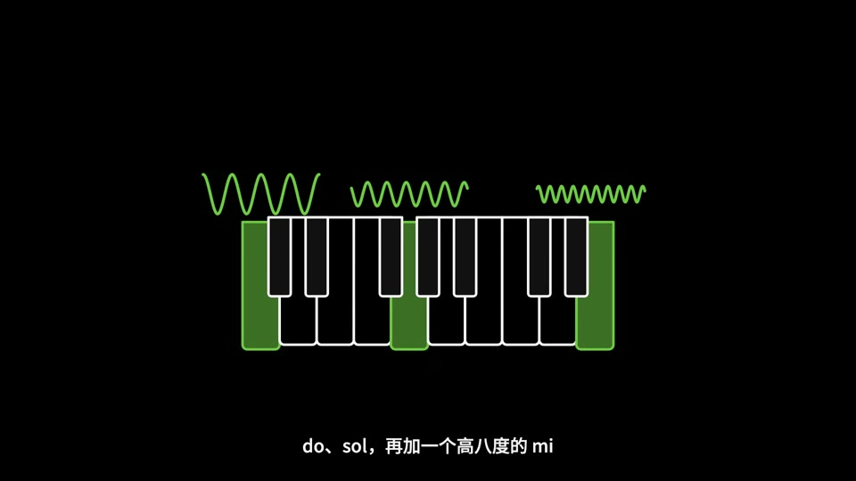
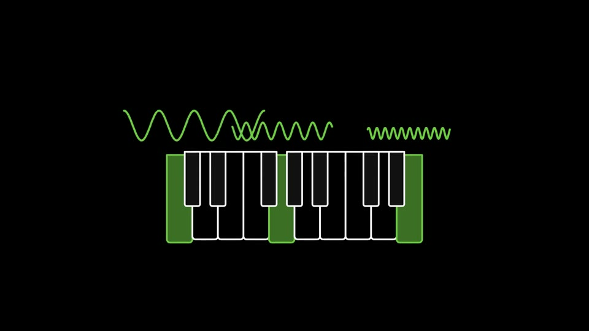

# template-2

> 由 ds-remotion-dashboard 从「【vibe知识大赏】傅立叶变换，终于有人把它讲明白了」沉淀的可复用 Remotion 模版（共享工程结构：组件位于 shared/src/compositions/template-2/）。

## 内容标签
`通用`

## 风格与动画形式
- 风格：极简排版
- 动画主体形式：文字排版动画
- 模版来源：AI 生成（参考关键帧）
- 摘要：规则模式：仅依据标题生成的粗略判断，请在人工确认工作台核对关键帧后修正。

## 合成结构
- 分辨率：1920×1080
- 帧率：30 fps
- 时长：180 帧（约 6 秒）
- 关键动画：见 TemplateComponent.tsx

## 参考帧（原视频关键帧，供对照修改）





## 使用场景
- 通用 类短片，可作为片头 / 转场 / 循环背景元素复用。

## 如何渲染
在共享工程 `shared/` 目录下：

```bash
cd shared
npx remotion render src/index.ts template-2 src/compositions/template-2/preview.mp4
```

## 自定义
- 文案/配色：改 `meta.json` 的 `defaultProps`（title/subtitle/bgFrom/bgTo/accentFrom/accentTo），不动动画逻辑。
- 动画逻辑：改 `TemplateComponent.tsx`（可对照 refs/ 下的原视频关键帧微调）。

- 主色：`#0f172a` → `#334155`
- 背景：`#f8fafc` → `#e2e8f0`

## 来源
源视频：https://www.youtube.com/watch?v=TrCg2Bpvw4Y

