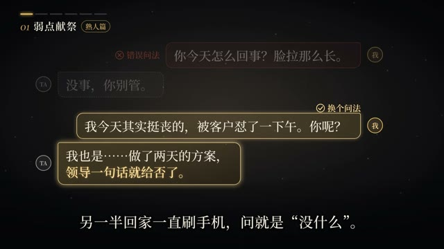
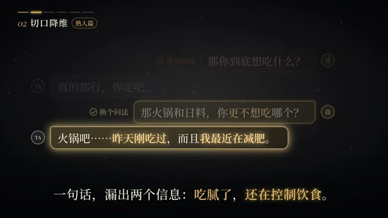

# template-3-s0

> 由 ds-remotion-dashboard 从「《话术博弈》如何优雅的套出对方的真心话？」沉淀的可复用 Remotion 模版（共享工程结构：组件位于 shared/src/compositions/template-3-s0/）。

## 内容标签
`聊天气泡` `话术对比` `编号标签`

## 风格与动画形式
- 风格：黑金暗色调聊天界面模拟
- 动画主体形式：文字排版动画
- 模版来源：AI 生成（参考关键帧）
- 摘要：左上角出现编号标签「01 弱点献祭 / 02 切口降维」配胶囊形分类徽章，画面中部模拟聊天界面：灰色气泡为「错误问法」，金色描边气泡为「换个问法」示范，气泡带 TA/我 头像圆标逐条浮现，底部衬一行白色解说字幕，深黑背景配暗金点缀。

## 合成结构
- 分辨率：1920×1080
- 帧率：30 fps
- 时长：600 帧（约 20 秒）
- 关键动画：见 TemplateComponent.tsx

## 参考帧（原视频关键帧，供对照修改）



## 使用场景
- 聊天气泡 类短片，可作为片头 / 转场 / 循环背景元素复用。

## 如何渲染
在共享工程 `shared/` 目录下：

```bash
cd shared
npx remotion render src/index.ts template-3-s0 src/compositions/template-3-s0/preview.mp4
```

## 自定义
- 文案/配色：改 `meta.json` 的 `defaultProps`（title/subtitle/bgFrom/bgTo/accentFrom/accentTo），不动动画逻辑。
- 动画逻辑：改 `TemplateComponent.tsx`（可对照 refs/ 下的原视频关键帧微调）。

- 主色：`#38bdf8` → `#818cf8`
- 背景：`#0f172a` → `#020617`

## 来源
源视频：https://www.bilibili.com/video/BV1yVn16XEz7/?spm_id_from=333.337.search-card.all.click

