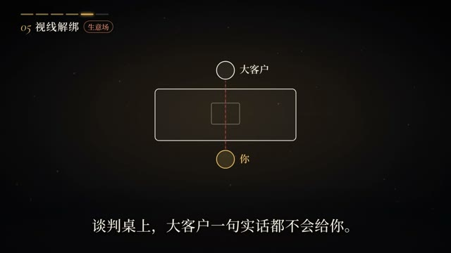
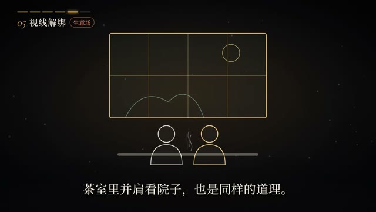

# template-3-s2

> 由 ds-remotion-dashboard 从「《话术博弈》如何优雅的套出对方的真心话？」沉淀的可复用 Remotion 模版（共享工程结构：组件位于 shared/src/compositions/template-3-s2/）。

## 内容标签
`线框人物` `视线示意` `关系图解`

## 风格与动画形式
- 风格：极简线框示意图
- 动画主体形式：图标动效
- 模版来源：文字排版
- 摘要：编号「05 视线解绑」标签下，暗金细线勾勒示意图：上下两个圆圈分别标注「大客户」「你」，中间矩形框代表谈判桌；随后切换为并排坐的两个线框小人面向庭院方格窗景，线条极简，底部配白色解说字幕，演示视线朝向的关系变化。

## 合成结构
- 分辨率：1920×1080
- 帧率：30 fps
- 时长：600 帧（约 20 秒）
- 关键动画：见 TemplateComponent.tsx

## 参考帧（原视频关键帧，供对照修改）



## 使用场景
- 线框人物 类短片，可作为片头 / 转场 / 循环背景元素复用。

## 如何渲染
在共享工程 `shared/` 目录下：

```bash
cd shared
npx remotion render src/index.ts template-3-s2 src/compositions/template-3-s2/preview.mp4
```

## 自定义
- 文案/配色：改 `meta.json` 的 `defaultProps`（title/subtitle/bgFrom/bgTo/accentFrom/accentTo），不动动画逻辑。
- 动画逻辑：改 `TemplateComponent.tsx`（可对照 refs/ 下的原视频关键帧微调）。

- 主色：`#0f172a` → `#334155`
- 背景：`#f8fafc` → `#e2e8f0`

## 来源
源视频：https://www.bilibili.com/video/BV1yVn16XEz7/?spm_id_from=333.337.search-card.all.click

