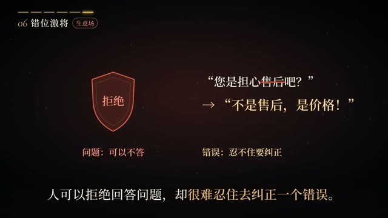

# template-3-s3

> 由 ds-remotion-dashboard 从「《话术博弈》如何优雅的套出对方的真心话？」沉淀的可复用 Remotion 模版（共享工程结构：组件位于 shared/src/compositions/template-3-s3/）。

## 内容标签
`盾牌图标` `问句纠正` `对比排版`

## 风格与动画形式
- 风格：图标加文字对比排版
- 动画主体形式：图标动效
- 模版来源：文字排版
- 摘要：编号「06 错位激将」标签下，左侧暗红描边盾牌图标内嵌「拒绝」二字，右侧上下排列白色问句「您是担心售后吧？」与金色纠正句「不是售后，是价格！」，下方小字标注「问题：可以不答 / 错误：忍不住要纠正」形成对照，底部一行解说字幕收尾。

## 合成结构
- 分辨率：1920×1080
- 帧率：30 fps
- 时长：180 帧（约 6 秒）
- 关键动画：见 TemplateComponent.tsx

## 参考帧（原视频关键帧，供对照修改）


## 使用场景
- 盾牌图标 类短片，可作为片头 / 转场 / 循环背景元素复用。

## 如何渲染
在共享工程 `shared/` 目录下：

```bash
cd shared
npx remotion render src/index.ts template-3-s3 src/compositions/template-3-s3/preview.mp4
```

## 自定义
- 文案/配色：改 `meta.json` 的 `defaultProps`（title/subtitle/bgFrom/bgTo/accentFrom/accentTo），不动动画逻辑。
- 动画逻辑：改 `TemplateComponent.tsx`（可对照 refs/ 下的原视频关键帧微调）。

- 主色：`#0f172a` → `#334155`
- 背景：`#f8fafc` → `#e2e8f0`

## 来源
源视频：https://www.bilibili.com/video/BV1yVn16XEz7/?spm_id_from=333.337.search-card.all.click

