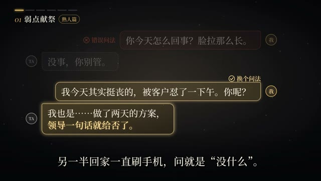
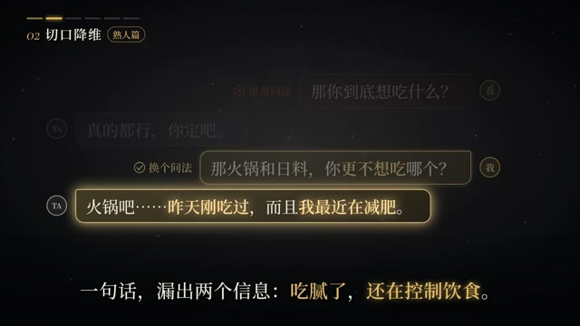

# template-talk-tactics-s1

> 由 ds-remotion-dashboard 从「《话术博弈》如何优雅的套出对方的真心话？」沉淀的可复用 Remotion 模版（共享工程结构：组件位于 shared/src/compositions/template-talk-tactics-s1/）。

## 内容标签
`对话循环` `气泡弹跳` `人物插画`

## 风格与动画形式
- 风格：扁平插画
- 动画主体形式：循环元素
- 模版来源：AI 生成（参考关键帧）
- 摘要：左右两个简笔人物侧脸面对面对话，中间三个圆形聊天气泡交替弹跳，气泡内省略号上下浮动，背景有半透明浅蓝圆环持续扩散，表现试探性对话。

## 合成结构
- 分辨率：1920×1080
- 帧率：30 fps
- 时长：210 帧（约 7 秒）
- 关键动画：见 TemplateComponent.tsx

## 参考帧（原视频关键帧，供对照修改）



## 使用场景
- 对话循环 类短片，可作为片头 / 转场 / 循环背景元素复用。

## 如何渲染
在共享工程 `shared/` 目录下：

```bash
cd shared
npx remotion render src/index.ts template-talk-tactics-s1 src/compositions/template-talk-tactics-s1/preview.mp4
```

## 自定义
- 文案/配色：改 `meta.json` 的 `defaultProps`（title/subtitle/bgFrom/bgTo/accentFrom/accentTo），不动动画逻辑。
- 动画逻辑：改 `TemplateComponent.tsx`（可对照 refs/ 下的原视频关键帧微调）。

- 主色：`#f97316` → `#fbbf24`
- 背景：`#fef3c7` → `#fde68a`

## 来源
源视频：https://www.bilibili.com/video/BV1yVn16XEz7/?spm_id_from=333.337.search-card.all.click

