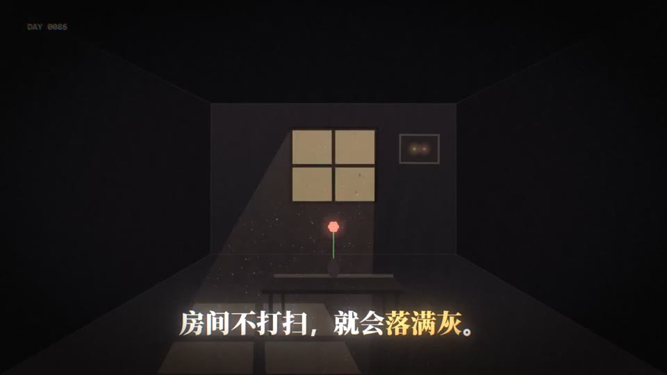
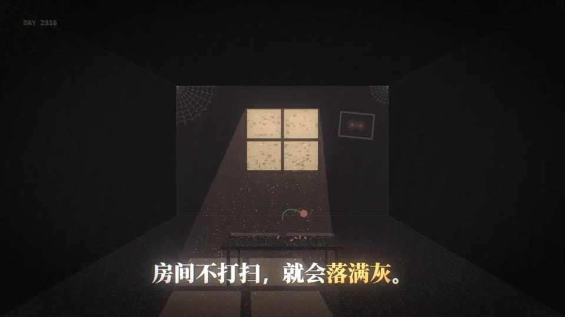
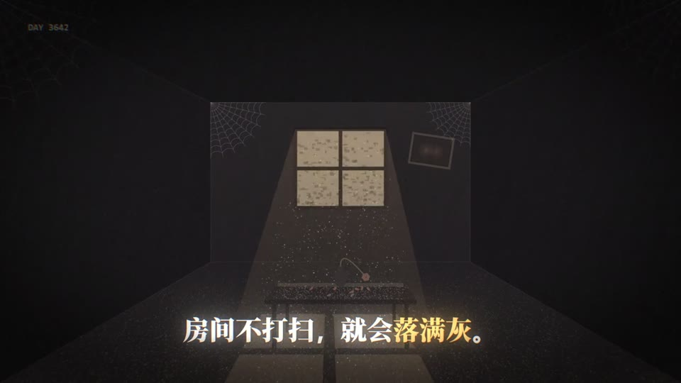
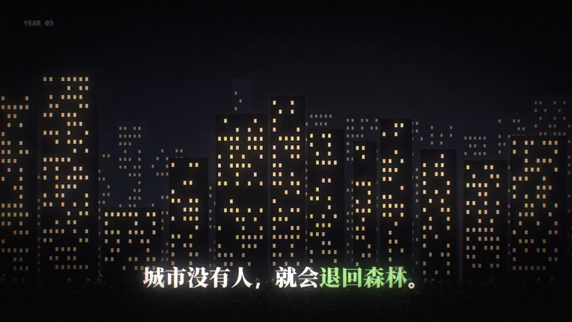

# template

> 由 ds-remotion-dashboard 从「「Vibe知识大赏」看懂了熵增 ，就原谅了生」沉淀的可复用 Remotion 模版（共享工程结构：组件位于 shared/src/compositions/template/）。

## 内容标签
`科普` `知识` `数学` `优化` `局部最优`

## 风格与动画形式
- 风格：扁平插画
- 动画主体形式：文字排版动画
- 模版来源：AI 生成（参考关键帧）
- 摘要：快节奏科普短片，以大字排版动画为主、扁平插画为辅，用潮流卡点剪辑把'熵增'物理概念讲到人生释然，节奏轻快、金句密集。

## 合成结构
- 分辨率：1920×1080
- 帧率：30 fps
- 时长：450 帧（约 15 秒）
- 关键动画：`大字标题逐字弹入（spring 缩放+上移）`、`关键词高亮色块随节拍展开`、`金句卡片卡点切换（硬切+位移残影）`、`扁平插画元素缓慢浮动/循环脉冲点`、`概念词（熵增→释然）渐变过渡转场`

## 参考帧（原视频关键帧，供对照修改）





## 使用场景
- 科普 类短片，可作为片头 / 转场 / 循环背景元素复用。

## 如何渲染
在共享工程 `shared/` 目录下：

```bash
cd shared
npx remotion render src/index.ts template src/compositions/template/preview.mp4
```

## 自定义
- 文案/配色：改 `meta.json` 的 `defaultProps`（title/subtitle/bgFrom/bgTo/accentFrom/accentTo），不动动画逻辑。
- 动画逻辑：改 `TemplateComponent.tsx`（可对照 refs/ 下的原视频关键帧微调）。

- 主色：`#f97316` → `#fbbf24`
- 背景：`#fef3c7` → `#fde68a`

## 来源
源视频：https://www.xiaohongshu.com/discovery/item/6abf0a4e000000001301af3f?source=webshare&xhsshare=pc_web&xsec_token=AB95PPOpBqW3pVAE48pgQjuBemr7a7bS2HooCe1E75JkY=&xsec_source=pc_share

