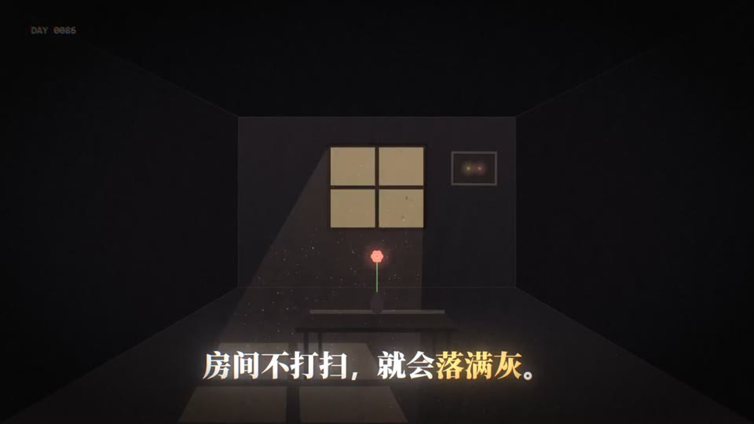
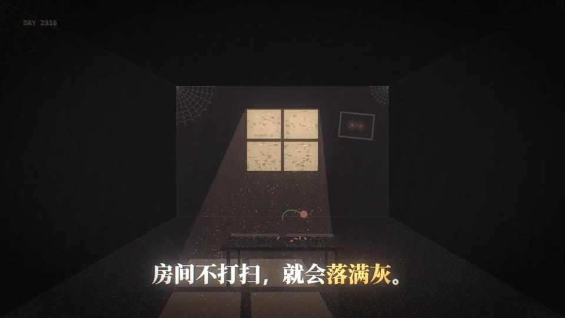
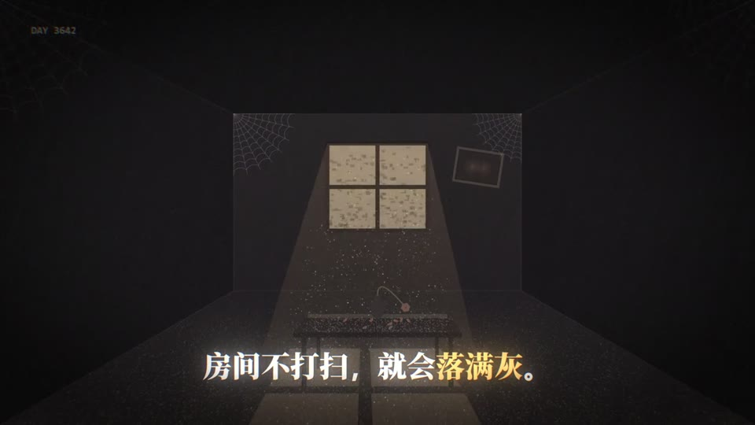
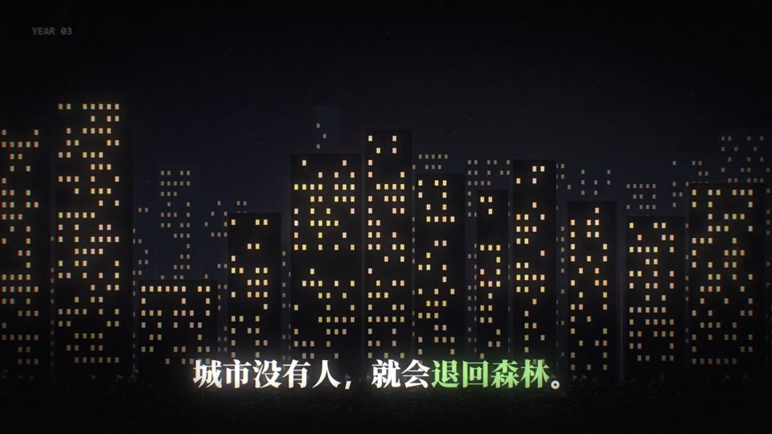

# template

> 由 ds-remotion-dashboard 从「「Vibe知识大赏」看懂了熵增 ，就原谅了生」沉淀的可复用 Remotion 模版。

## 内容标签
`科普` `知识` `物理` `哲学` `人生感悟`

## 风格与动画形式
- 风格：扁平插画
- 动画主体形式：文字排版动画
- 模版来源：文字排版
- 摘要：快节奏科普短片，以大字排版动画为主、扁平插画为辅，用潮流卡点剪辑把'熵增'物理概念讲到人生释然，节奏轻快、金句密集。

## 合成结构
- 分辨率：1920×1080
- 帧率：30 fps
- 时长：450 帧（约 15 秒）
- 关键动画：`大字标题逐字弹入（spring 缩放+上移）`、`关键词高亮色块随节拍展开`、`金句卡片卡点切换（硬切+位移残影）`、`扁平插画元素缓慢浮动/循环脉冲点`、`概念词（熵增→释然）渐变过渡转场`

## 参考帧（原视频关键帧，供对照修改）





## 使用场景
- 科普 类短片，可作为片头 / 转场 / 循环背景元素复用。

## 如何使用
在模版目录内（node_modules 复用 remotion 环境）：

```bash
pnpm render            # 或 npm run render
# 等价于：remotion render src/index.ts MainTemplate preview.mp4
```

## 自定义
修改 `src/Composition.tsx` 中 `TemplateComposition` 的 `defaultProps`（标题/配色/合成参数），
即可在不改动画逻辑的情况下复用本模版。动画主体组件在文件内按需调整参数；
可对照 refs/ 下的原视频关键帧，微调元素位置/颜色/节奏。

- 主色：`#f97316` → `#fbbf24`
- 背景：`#fef3c7` → `#fde68a`

## 来源
源视频：https://www.xiaohongshu.com/discovery/item/6abf0a4e000000001301af3f?source=webshare&xhsshare=pc_web&xsec_token=AB95PPOpBqW3pVAE48pgQjuBemr7a7bS2HooCe1E75JkY=&xsec_source=pc_share

